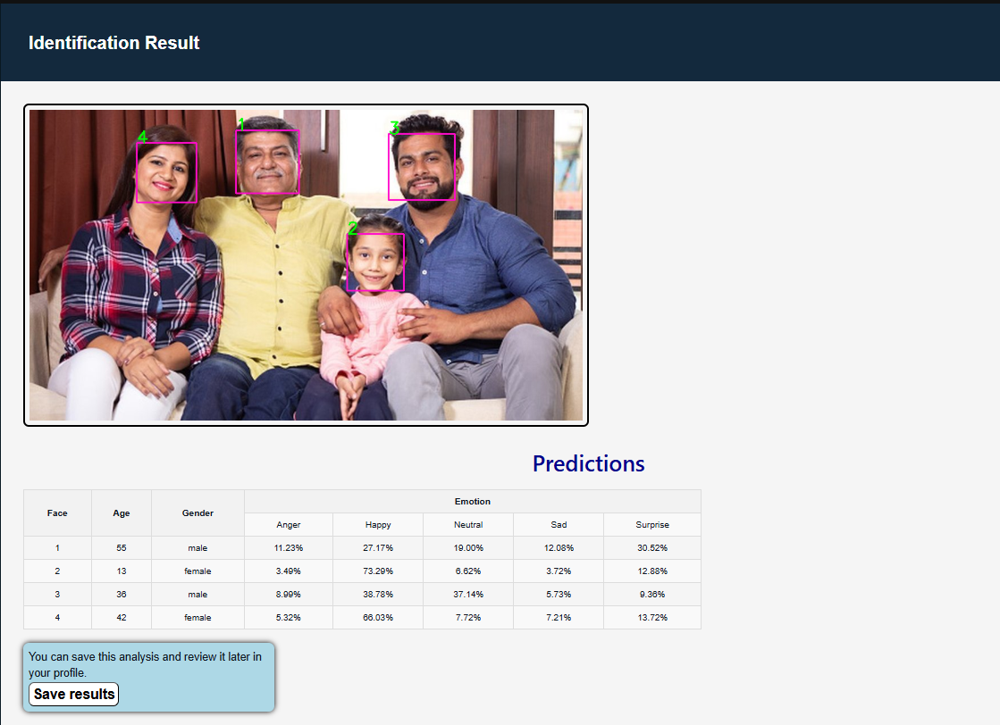
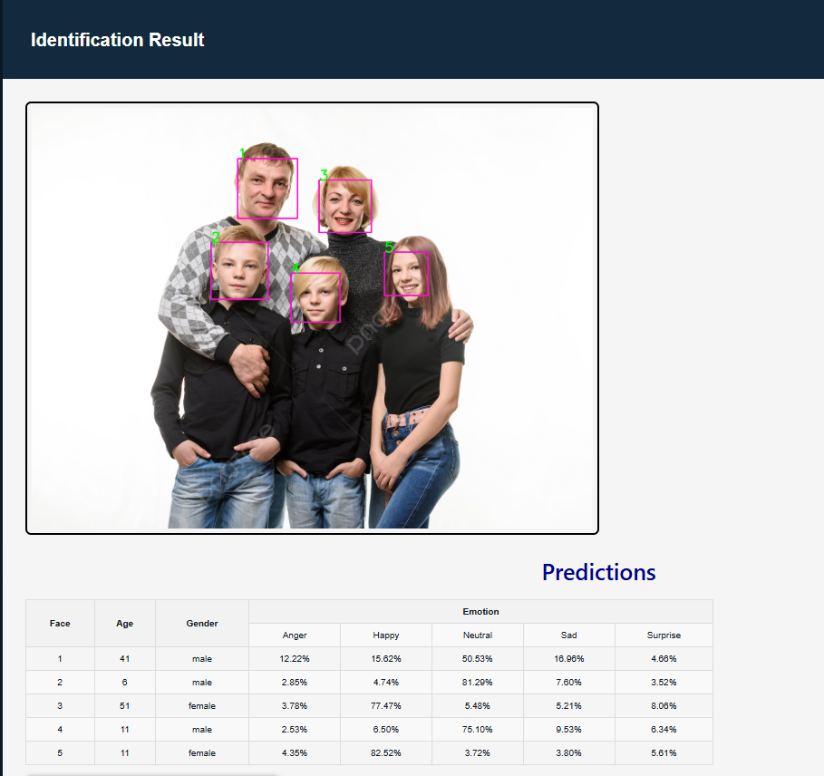

# AI Face Analysis System

A Django computer vision application for face image analysis. The app accepts uploaded images or image URLs, detects faces, and displays estimated age, gender, and emotion attributes.

The repository also includes model experiment notebooks comparing CNN, transformer, and hybrid architectures for facial attribute estimation.

## Preview

Example predictions generated by the model:





## Features

- Django web interface for image upload and URL-based image input
- Face detection using an OpenCV Haar cascade
- Local Keras/TensorFlow inference for age, gender, and emotion
- Demo-safe fallback when model weights are not available
- Account flow for signing in and saving analysis results
- Test suite for the main web and account workflows
- Documentation for architecture, model results, and future work

## Repository Layout

```text
.
|-- django_app/   # Django application and runtime inference code
|-- notebooks/    # Training notebooks and experiment results
|-- docs/         # Architecture and model notes
|-- .env.example
|-- .gitignore
`-- README.md
```

## Model Experiments

The notebooks compare CNN, transformer, and hybrid architectures:

| Task | Best reported model | Metric summary |
| --- | --- | --- |
| Age regression | ConvNeXt | MAE 4.95, MSE 51.13 |
| Gender classification | ConvNeXt | Accuracy 0.9475, F1 0.9489 |
| Emotion classification | ConvNeXt | Accuracy 0.848, F1 0.85 |

See [docs/model-results.md](docs/model-results.md) for the full comparison.

## Local Setup

Use Python 3.11 for the full application, including TensorFlow inference.

```powershell
cd django_app
python -m venv .venv
.\.venv\Scripts\activate
pip install -r requirements-ml.txt
python manage.py migrate
python manage.py runserver
```

For a lighter web-only setup without TensorFlow/OpenCV, install `requirements.txt` instead of `requirements-ml.txt`.

Optional local configuration can be created from the example file:

```powershell
copy ..\.env.example .env
```

The default settings are suitable for local SQLite development. Keep the real `.env` file out of Git.

Open the app at:

```text
http://127.0.0.1:8000/
```

## Tests

```powershell
cd django_app
.\.venv\Scripts\activate
python manage.py check
python manage.py test
```

## Model Weights

Datasets, uploaded media, and trained model weights are not stored in Git.

Expected local model layout:

```text
django_app/
`-- ml/
    |-- age_model.h5
    |-- gender.h5
    `-- emotion.h5
```

These paths are documented in `.env.example`:

```env
MODEL_DIR=ml
AGE_MODEL_PATH=ml/age_model.h5
GENDER_MODEL_PATH=ml/gender.h5
EMOTION_MODEL_PATH=ml/emotion.h5
```

Without local model files, the Django app still starts and uses a demo-safe fallback for the web flow.

## Optional Azure Dependencies

Azure ML deployment dependencies are separated from local inference:

```powershell
pip install -r requirements-azure.txt
```

They are not required for local development or model inference.

## Documentation

- [Architecture](docs/architecture.md)
- [Model results](docs/model-results.md)
- [Development roadmap](docs/development-roadmap.md)